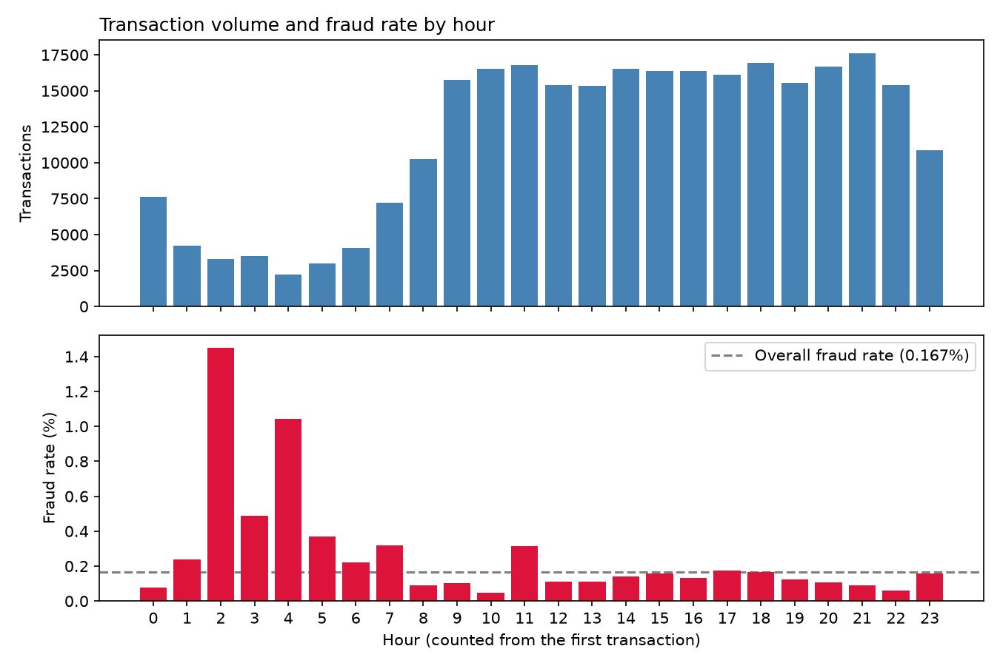
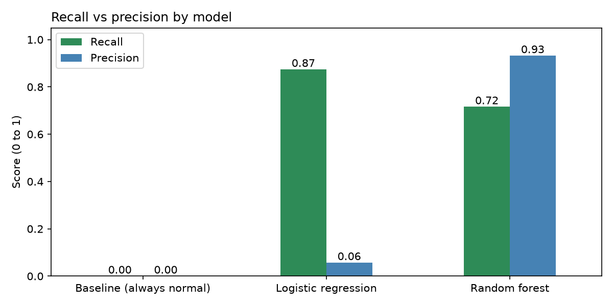
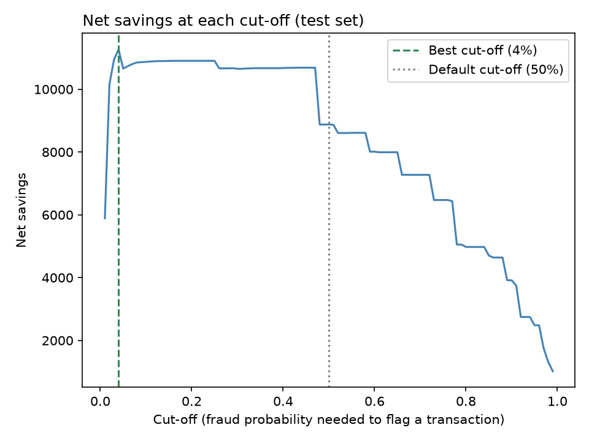

# Credit Card Fraud Detection

Can a model automatically flag fraudulent card transactions, and how much money would it save?

This project explores 284,807 real (anonymised) credit card transactions with SQL and Python, trains machine learning models
to detect fraud, and turns the results into an estimated business impact and a recommendation.

**Tools:** Python, SQL (DuckDB), pandas, scikit-learn, matplotlib, Jupyter, Git

## Key results

- Fraud is only **0.167%** of transactions, so a model that never flags fraud would still be **99.8% accurate**. Models were therefore judged on **recall** and **precision**, not accuracy.
- The best model (**random forest**) caught **68 of 95 frauds** in unseen test data with only **5 false alarms**.
- Lowering the decision cut-off from 50% raised estimated net savings by **27%**, recovering **76%** of the value of fraud in the test set.

## Data

[Credit Card Fraud Detection](https://www.kaggle.com/datasets/mlg-ulb/creditcardfraud) (Kaggle): transactions made by European cardholders over two days.

- `V1`–`V28`: transaction details anonymised with PCA to protect customer privacy, so their meaning is unknown
- `Time`: seconds since the first transaction; `Amount`: transaction value (currency not stated, likely euros)
- `Class`: 1 = fraud, 0 = normal
- 1,081 duplicate rows were removed, leaving **283,726 transactions (473 fraud)**

## Approach

The project is split into three notebooks, run in order:

| Notebook | What it does |
|---|---|
| `01_exploration.ipynb` | Data quality checks and SQL analysis of fraud patterns by amount and time of day |
| `02_modelling.ipynb` | Trains a baseline, logistic regression and random forest, and compares them on unseen test data |
| `03_business_impact.ipynb` | Converts model results into money saved and finds the most profitable decision cut-off |

## 1. Exploration



- **Fraud is concentrated at night:** the quietest hours (likely night-time) contain 7% of transactions but 25% of all fraud.
- **Most fraud is small:** the median fraud is 9.82 vs 22.00 for normal transactions, possibly fraudsters testing stolen cards.
- **Large transactions are riskier:** amounts over 500 are about twice as likely to be fraud as average.

## 2. Modelling

Models were trained on 80% of the data and tested on the 20% they had never seen.

| Model | Recall | Precision | PR-AUC | Frauds caught (of 95) | False alarms |
|---|---|---|---|---|---|
| Baseline (always "normal") | 0.000 | 0.000 | 0.002 | 0 | 0 |
| Logistic regression | 0.874 | 0.057 | 0.668 | 83 | 1,369 |
| **Random forest** | **0.716** | **0.932** | **0.764** | **68** | **5** |



Logistic regression catches more fraud but wrongly flags 1,369 genuine customers. The random forest gives the best balance
and the highest PR-AUC, so it was chosen as the final model.

## 3. Business impact

Assumptions: catching a fraud saves the transaction amount; each false alarm costs 5 (support time and customer frustration).



| Cut-off | Frauds caught | False alarms | Net savings |
|---|---|---|---|
| Default (50%) | 69 | 5 | 8,879 |
| Best (4%) | 77 | 87 | 11,265 |

**Recommendation:** lower the cut-off to around **10–20%**. This captures almost all of the extra savings (around 10,900)
while staying clear of the sharp drop in savings below 3%, where false alarms overwhelm the gains.

## Limitations and next steps

- Only two days of data. Time patterns and savings should be confirmed over a longer period.
- Anonymised features mean the model's decisions can't be fully explained, a real trade-off between privacy and explainability.
- The false alarm cost is an assumption, and the cut-off was chosen on the test set, so savings are slightly optimistic.
- **Next steps:** choose the cut-off on a separate validation set, try other models (e.g. XGBoost), and test on later
  transactions only (train on day 1, test on day 2).

## How to run

```bash
git clone https://github.com/Leviano1/fraud-detection-analysis.git
cd fraud-detection-analysis
python -m venv venv
venv\Scripts\activate #Windows. (Mac/Linux: source venv/bin/activate)
pip install -r requirements.txt
```

1. Download `creditcard.csv` from [Kaggle](https://www.kaggle.com/datasets/mlg-ulb/creditcardfraud) and place it in `data/`.
2. Run the notebooks in order. `02_modelling.ipynb` saves the trained model to `models/`, which `03_business_impact.ipynb` loads.